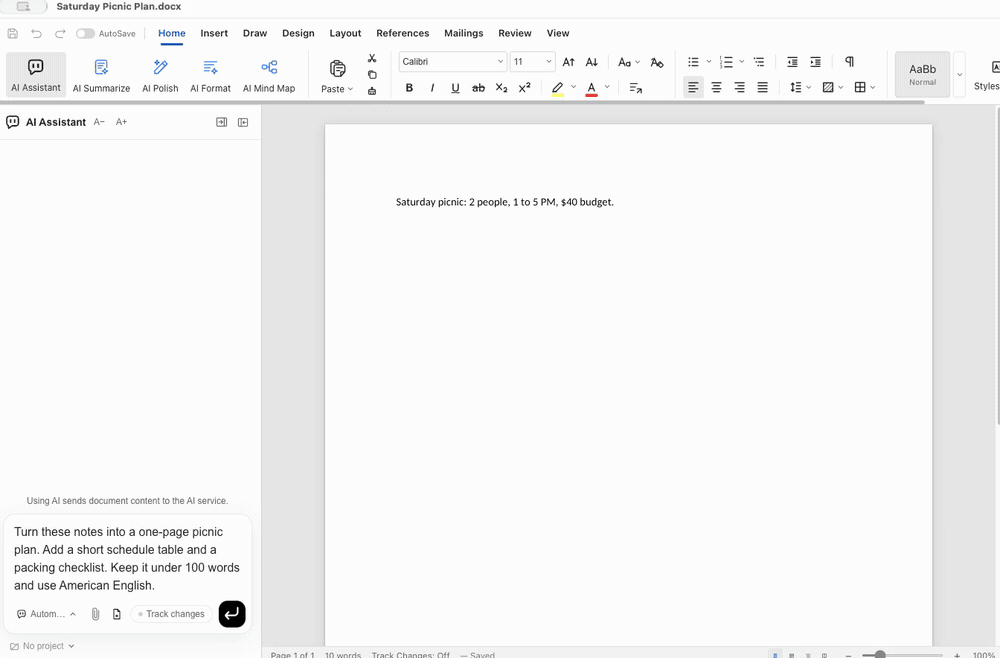
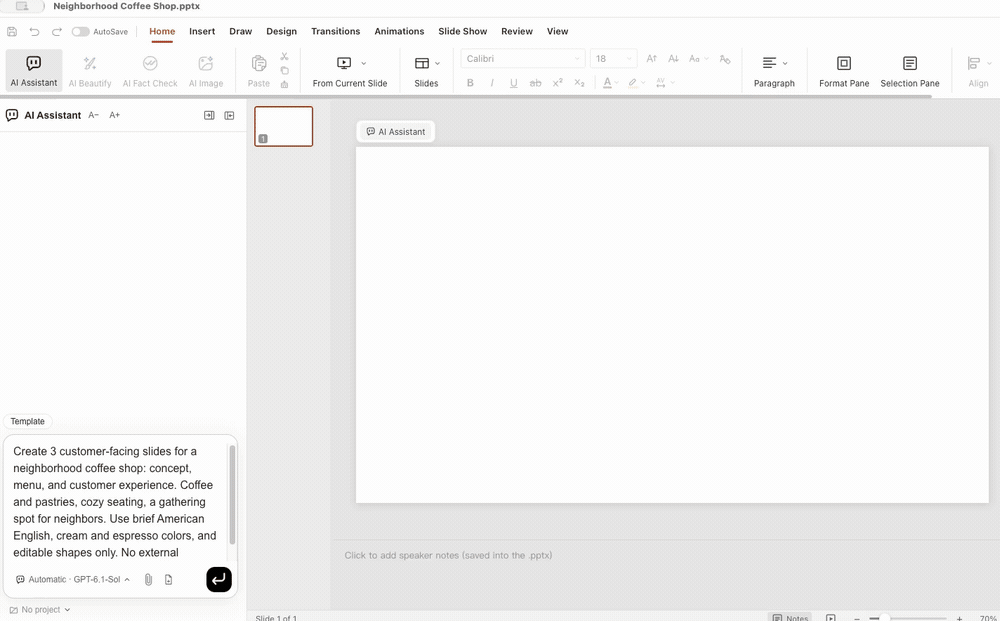
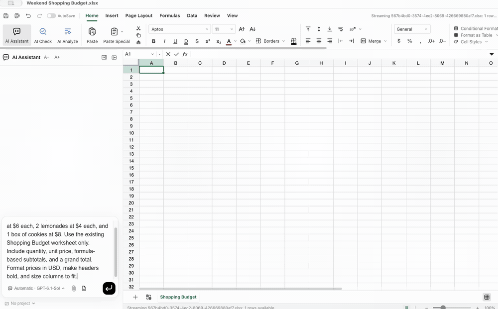
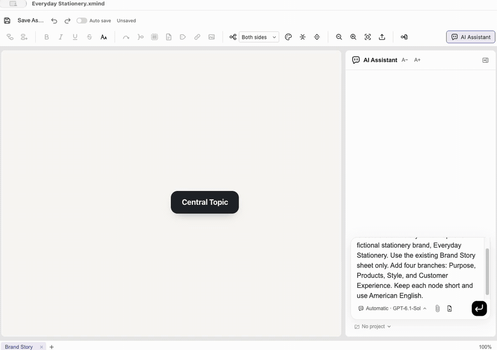

<!-- Modified by Onyou Office on 2026-11-04. -->

<p align="center">
  
</p>

<h1 align="center">Onyou Office</h1>

<p align="center"><strong>An AI agent office, built for you.</strong></p>

<p align="center">
  <a href="LICENSE"></a>
  <a href="https://github.com/dodamworks/onyouoffice/actions/workflows/ci.yml"></a>
  <a href="https://github.com/dodamworks/onyouoffice/stargazers"></a>
</p>

Start with a document. Ask AI for a first draft, a clearer paragraph or an answer
from your files. Keep reading and editing in the same workspace.

Onyou Office is a free, open-source desktop office with AI agents alongside your
editors. Connect the AI service you choose, or work without AI.

<p align="center">
  <a href="https://github.com/dodamworks/onyouoffice/releases/latest">Download</a> ·
  <a href="#get-started">Get started</a> ·
  <a href="https://github.com/dodamworks/onyouoffice/issues">Report a bug</a> ·
  <a href="CONTRIBUTING.md">Contribute</a>
</p>

<details>
<summary>Read in your language · 21 languages</summary>

**English** · [العربية](docs/readme/i18n/ar.md) · [Čeština](docs/readme/i18n/cs.md) · [Deutsch](docs/readme/i18n/de.md) · [Español](docs/readme/i18n/es.md) · [Français](docs/readme/i18n/fr.md) · [עברית](docs/readme/i18n/he.md) · [हिन्दी](docs/readme/i18n/hi.md) · [Bahasa Indonesia](docs/readme/i18n/id.md) · [Italiano](docs/readme/i18n/it.md) · [日本語](docs/readme/i18n/ja.md) · [한국어](docs/readme/i18n/ko.md) · [Bahasa Melayu](docs/readme/i18n/ms.md) · [Nederlands](docs/readme/i18n/nl.md) · [Polski](docs/readme/i18n/pl.md) · [Português](docs/readme/i18n/pt.md) · [Русский](docs/readme/i18n/ru.md) · [ไทย](docs/readme/i18n/th.md) · [Tiếng Việt](docs/readme/i18n/vi.md) · [简体中文](docs/readme/i18n/zh.md) · [繁體中文](docs/readme/i18n/zh-TW.md) <!-- lang-switcher -->

</details>

## See AI at work

### Documents

[](docs/readme/demos/document.mp4)

### Presentations

[](docs/readme/demos/presentation.mp4)

### Spreadsheets

[](docs/readme/demos/spreadsheet.mp4)

### Mind maps

[](docs/readme/demos/mindmap.mp4)

## One workspace for your documents

- **Write and edit:** documents, spreadsheets, presentations and Hangul (HWP/HWPX).
- **Draw diagrams:** edit draw.io files and import Visio (.vsdx) locally as new diagrams.
- **Read and organize:** PDF, Markdown, HTML, mind maps and EPUB, with editing and
  conversion tools that vary by format.
- **Work with AI:** request document changes in the AI assistant, ask questions
  across a chosen document scope in Knowledge Vault, and keep project instructions,
  memory, files and conversations together.
- **Make it yours:** 21 interface languages, light and dark themes, and adjustable
  AI chat text size.

### From a first draft to a finished file

1. **Open or create.** Bring an existing file into a tab or start a new document.
2. **Ask for what you need.** Draft, revise or ask about selected documents through
   the AI assistant and Knowledge Vault.
3. **Review and keep working.** Edit the result in the document, then save or export
   using the tools available for that format.

## Get started

Download installers from [Releases](https://github.com/dodamworks/onyouoffice/releases/latest): **Windows x64**,
**macOS Apple Silicon / Intel (beta)** and **Linux x64 (beta)**.
Updates are installed manually for this first release.

To build from source, install Node.js 24, npm, Rust (`cargo`) and your platform's native build tools.

```sh
git clone https://github.com/dodamworks/onyouoffice.git
cd onyouoffice
npm ci
npm run fixtures
npm run build:all
npm run dev
```

From Home, open a file or create a document. To use AI, choose a connection in
**Settings → AI**, then type a request in the document's AI assistant.
For setup details and checks, see [Contributing](CONTRIBUTING.md).

## AI, cost and your data

Document editing does not require an AI account. AI subscriptions, API charges
and usage limits are separate and follow your chosen provider's terms.
The app includes Codex, Claude, direct ChatGPT, OpenRouter, Gemini, API-key and
local AI connection paths; their setup requirements and availability differ.

Using AI sends relevant document content, attachments and conversation to the
selected provider. Read [Privacy](PRIVACY.md) before connecting confidential files.
Development runs use a separate app-data folder from installed builds.

**Known limitations:** Knowledge Vault questions and follow-up conversations were
verified through the official Codex program. Direct ChatGPT login has a known
provider-consent error and is not a verified route. File-format support does not
promise identical rendering or full compatibility with other office applications.
See [known issues](docs/tracking/findings.md) and [release status](docs/PUBLIC-RELEASE.md).

## Help and contribute

Report bugs, suggest improvements or contribute translations and code through
[Issues](https://github.com/dodamworks/onyouoffice/issues) and pull requests.
Use synthetic examples; do not upload personal documents, keys or account details.
Report vulnerabilities through [Security](SECURITY.md).
For other questions: **support@onyouoffice.com**.

- [Architecture](docs/architecture.md)
- [Development guide](docs/dodam/README.md)
- [README translation guide](docs/readme/README.md)

## License and origins

Onyou Office is an independent fork of [IeumOffice](https://github.com/pblsketch/openoffice),
itself based on [GenOffice](https://github.com/genspark-ai/genoffice).
We credit their authors, rhwp and other open-source contributors and record the
accepted upstream revision. These projects supply the document-engine foundation;
Onyou Office does not claim to have authored all inherited functionality.
See [upstream integration](docs/dodam/UPSTREAM-INTEGRATION.md) and
[source history](docs/readme/SOURCE-HISTORY.md) for the accepted baseline and our changes.

Project source is licensed under [Apache-2.0](LICENSE).
Third-party components retain their own terms; see [NOTICE](NOTICE) and
[contributor credits](CONTRIBUTORS.md). Product and upstream trademarks are separate
from the source license: [brand usage](TRADEMARKS.md).
No affiliation or endorsement by upstream projects or AI/file-format vendors is claimed.
