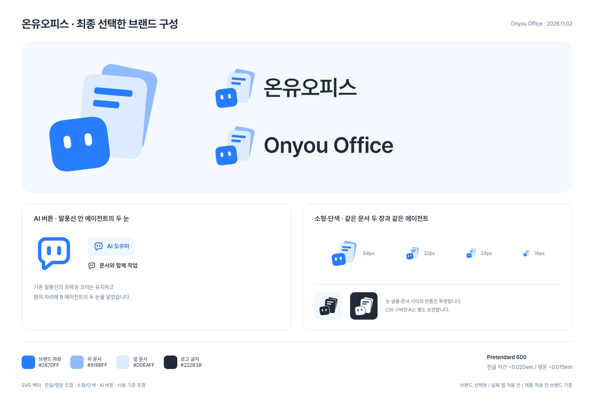
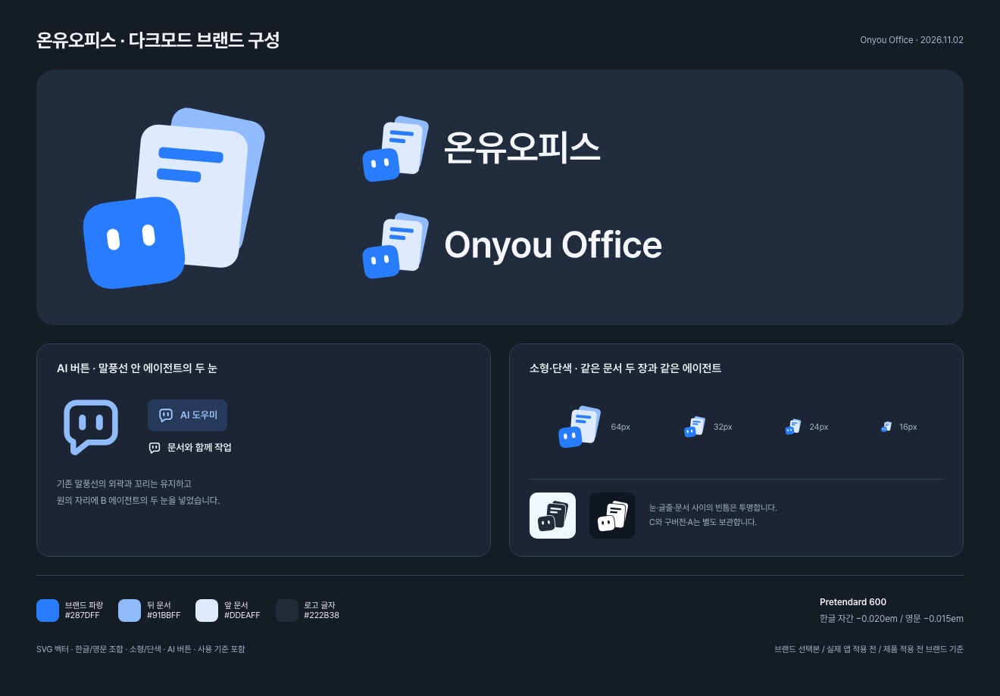

# 온유오피스 브랜드 사용 가이드

[English guide](README.md)

2026년 11월 2일, **문서 두 장과 에이전트로 구성한 B안**을 온유오피스 / Onyou Office의 기본 로고로 선택했습니다. C는 대안으로, 기존 원본과 A 수정본은 이력으로 보관합니다.

## 사용할 파일

- [기본 심벌](logos/symbol.svg): 선택한 B의 그림을 유지하고 캔버스 여백을 정리했습니다.
- [소형 심벌](logos/symbol-small.svg): 문서 두 장·배치·기울기·얼굴 외곽을 유지하고 눈과 글줄만 조금 키웠습니다.
- [어두운 단색](logos/symbol-mono.svg) / [흰 단색](logos/symbol-white.svg): 눈·글줄·문서 사이의 빈틈이 실제로 뚫린 벡터입니다.
- [한글 조합](logos/logo-ko.svg) / [영문 조합](logos/logo-en.svg): 온유오피스 / Onyou Office 가로 로고입니다.

편집 원본은 SVG입니다. PNG는 필요한 크기로 그때 출력하면 됩니다. 로고 글자는 경로로 변환해 폰트가 설치되지 않은 환경에서도 같은 형태로 보입니다.

## 색과 서체

| 역할                  | 색상      |
| --------------------- | --------- |
| 에이전트·글줄         | `#287DFF` |
| 뒤 문서               | `#91BBFF` |
| 앞 문서               | `#DDEAFF` |
| 컬러 심벌의 눈        | `#FFFFFF` |
| 로고 글자·어두운 단색 | `#222B38` |

한글·영문 모두 **Pretendard 600**을 사용합니다. 기본 조판과 커닝 뒤에 더한 자간은 한글 **−0.020em**, 영문 **−0.015em**입니다. 다른 회사의 자간값이 아닌 온유오피스용 설정입니다. 폰트의 글자 모양을 사용했으며 전용 서체를 새로 만든 것은 아닙니다.

[Pretendard v1.3.9](fonts/PretendardVariable.woff2)와 [OFL 원문](fonts/Pretendard-OFL.txt)을 함께 보관합니다. 데스크톱 앱 상단의 제품명은 이 실제 글꼴로 표시합니다. 나머지 UI 글꼴과 문서 본문 서식은 바꾸지 않습니다.

## 크기와 여백

- 기본 심벌은 **48px 이상**, 소형 심벌은 **16–32px**부터 검토합니다. 16px에서는 눈과 문서가 몇 픽셀로 축약되므로 실제 사용할 위치에서 확인합니다.
- 한글 가로 로고는 너비 **180px 이상**, 영문은 **220px 이상**을 시작 기준으로 합니다. 인쇄·운영체제별 최소 크기를 인증한 수치는 아닙니다.
- 실제 그림 바깥에 **파란 얼굴 너비의 1/4 이상** 여백을 둡니다. SVG 안의 투명 여백만으로 주변 공간이 확보됐다고 판단하지 않습니다.
- 심벌과 글자를 한 덩어리로 비례 확대·축소합니다. 기울기·눈 간격·문서 수·글자 비율을 바꾸지 않습니다.
- 밝은 바탕과 어두운 바탕 모두 컬러 심벌을 기본으로 사용합니다. 어두운 바탕에는 글자만 밝게 바꾼 다크 로고를 사용합니다. 한 색상으로 출력해야 할 때는 모든 도형을 같은 색으로 덮지 말고 제공한 단색판이나 흰 단색판을 사용합니다.
- 바닥 그림자·외곽선·그라데이션·머리카락처럼 보이는 상단 곡선 등의 장식을 추가하지 않습니다.

## 보관본

[archive](archive)에 [기존 원본](archive/original-dimensional.svg), [A1](archive/A1-no-floor.svg), [A2](archive/A2-no-floor-no-hair.svg), [A3](archive/A3-paper-edge.svg), [C](archive/C-one-document.svg)를 보관했습니다. A2가 사용자가 A3보다 선호한 수정안입니다. C를 B의 소형판으로 사용하지 않습니다.

[source](source)에는 선택 당시 B와 한글·영문 글자 원본이 있습니다. [출처·변경 기록](PROVENANCE.json)에 선택 내용, 광학 보정, 글꼴 출처와 파일 해시를 기록했습니다.

## 적용 범위

PR #3은 브랜드 자산과 사용 기준을 저장소에 남기는 작업입니다. 당시에는 실제 웹 구현과 앱·설치 아이콘 적용을 포함하지 않았습니다. 이후 로컬 데스크톱 적용은 아래 적용 기록에서 구분합니다. 실제 Dock·작업표시줄 확인과 제품 동작 검증도 해당 부분을 바꿀 때 진행합니다.

검증 범위와 결과는 [VALIDATION.md](VALIDATION.md)를 참고하세요. 이번 자료가 상표 등록이나 권리 검토의 완료를 뜻하지는 않습니다.

## AI 버튼·다크모드와 기존 프로젝트 연결

[AI 버튼](logos/ai-mark.svg)은 기존 말풍선 안의 원을 B 에이전트의 두 눈으로 바꿨습니다. 주변 글자 색을 따릅니다. 현재 로컬 데스크톱의 공용 React 컴포넌트에도 적용했으며, 아래 적용 기록에 검증 범위를 정리했습니다.

[한글 다크](logos/logo-ko-dark.svg) / [영문 다크](logos/logo-en-dark.svg)는 파란 심벌을 유지하고 글자만 밝게 처리합니다. 단색은 한 색상으로 써야 할 때의 보조 버전이며, 다크모드의 기본도 컬러 심벌입니다. 전체 로고를 반전하지 않습니다.

[언어·테마 선택 규칙](BRAND-SPEC.json), [기존 생성 도구용 입력](native-inputs/README.md), [연결 누락 점검](INTEGRATION-AUDIT.md), [출처 고지](SOURCE-NOTICES.md)를 함께 정리했습니다. ko는 한글 조합, 나머지는 영문 조합을 사용하는 기존 제품명 규칙을 따릅니다. 홈·업데이트 화면·공용 AI 버튼 등 실제 적용 지점도 기록했으며 앱 소스는 이 PR에서 변경하지 않습니다.

원 하나가 있던 [기존 AI 마크](archive/ai-mark-original.svg)도 보존했습니다.

## 데스크톱 적용 기록

2026년 11월 2일 `codex/desktop-brand`의 로컬 Mac 적용과 실제 화면 검증은 [데스크톱 적용 기록](../DESKTOP-BRAND-INTEGRATION.md)에 정리했습니다. 위 자료 PR의 검증 범위와 구분하며, 공개 배포나 모든 운영체제의 검증 완료를 뜻하지 않습니다.
