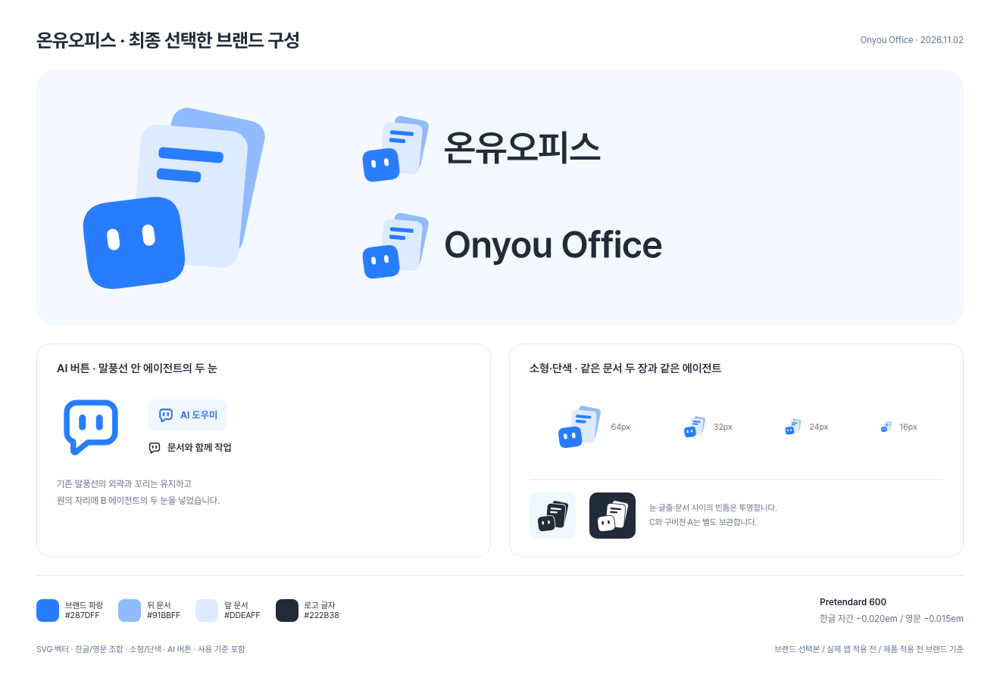
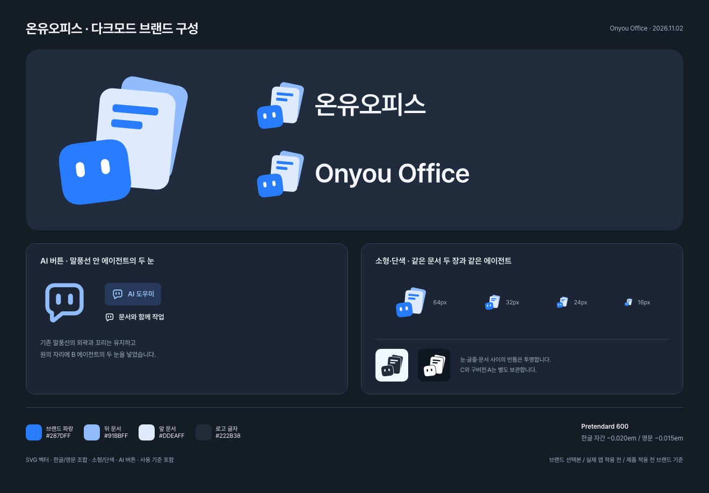

# Onyou Office brand identity

[한국어 가이드](README.ko.md)

On November 2, 2026, the user selected **B: an agent with two layered documents** as the primary logo for **온유오피스 / Onyou Office**. C remains an alternative, and the original and A revisions are preserved in [archive](archive). This directory is the maintained brand reference for subsequent website and desktop work.

## Files to use

| File                                       | Purpose                                                                            |
| ------------------------------------------ | ---------------------------------------------------------------------------------- |
| [symbol.svg](logos/symbol.svg)             | Primary colour symbol; selected B artwork with consistent canvas padding           |
| [symbol-small.svg](logos/symbol-small.svg) | Optical adjustment for small display sizes, retaining both documents and the agent |
| [symbol-mono.svg](logos/symbol-mono.svg)   | Single-ink version with transparent eyes, text and overlap separation              |
| [symbol-white.svg](logos/symbol-white.svg) | White single-ink version when one ink is required on a dark background             |
| [logo-ko.svg](logos/logo-ko.svg)           | Korean horizontal logo: 온유오피스                                                 |
| [logo-en.svg](logos/logo-en.svg)           | English horizontal logo: Onyou Office                                              |

Additional selected files: [Korean dark](logos/logo-ko-dark.svg), [English dark](logos/logo-en-dark.svg), and the [two-eye AI button](logos/ai-mark.svg).

Keep the coloured symbol as the primary mark in both themes; single-ink artwork is supplementary. Do not invert the whole coloured logo. Use the Korean lockup for the ko base language and the English lockup for other languages, matching productName(lang). [BRAND-SPEC.json](BRAND-SPEC.json) records these rules.

[Native inputs](native-inputs/README.md) record compatibility with the original generator. [INTEGRATION-AUDIT.md](INTEGRATION-AUDIT.md) preserves the asset-only PR findings. The current desktop integration uses live Pretendard text and the optical-small symbol, applies the shared two-eye AI mark, and generates colour-preserving previews; see the [desktop integration record](../DESKTOP-BRAND-INTEGRATION.md).

SVGs are the editable masters. Text in the logos is outlined, so rendering does not depend on installed fonts. Export PNGs at the actual required size instead of maintaining many duplicate raster exports.

## Colours

| Role                                 | HEX       | RGB           |
| ------------------------------------ | --------- | ------------- |
| Agent and document lines             | `#287DFF` | 40, 125, 255  |
| Rear document                        | `#91BBFF` | 145, 187, 255 |
| Front document                       | `#DDEAFF` | 221, 234, 255 |
| Eyes in colour artwork               | `#FFFFFF` | 255, 255, 255 |
| Wordmark and dark single-ink artwork | `#222B38` | 34, 43, 56    |

The colour artwork intentionally uses white eyes; the single-ink versions use real transparent counters. The symbol has no floor shadow, top highlight or gradient.

## Typography and spacing

Both wordmarks use **Pretendard 600**. Additional tracking is **−0.020em for Korean** and **−0.015em for English**, applied after HarfBuzz shaping and the font's kerning. These are Onyou Office logo settings, not another company's official values. The letterforms are font outlines rather than a newly drawn typeface.

The [Pretendard v1.3.9 WOFF2](fonts/PretendardVariable.woff2) and its unmodified [SIL Open Font License](fonts/Pretendard-OFL.txt) are included as the font reference. The desktop sidebar now embeds that same font for live product-name text; other UI typography and document contents retain their own fonts and formatting. No font package dependency was added.

## Usage rules

- Keep the mark proportional. Preserve the two-document composition, tilts, eye spacing and logo lockup relationships.
- Leave clear space of at least **one quarter of the blue face's width** around the visible artwork. Do not treat transparent canvas padding as an automatic substitute for surrounding layout space.
- Start with the primary symbol at **48px or larger**, and the optical version at **16–32px**. At 16px the documents and eyes reduce to a few pixels; check the actual target surface. These are screen starting points, not certified print or OS minimums.
- Start Korean horizontal logos at **180px wide**, and English horizontal logos at **220px wide**. Keep the lockup as one scaled object.
- Use the coloured symbol on both light and dark backgrounds. On dark backgrounds, use the supplied dark lockup, which changes only the wordmark foreground. Reserve the supplied mono or white artwork for single-ink output instead of recolouring every layer to the same ink.
- Preserve the supplied colours. Do not add shadows, outlines, hair-like highlights, gradients or decorative elements.

## Decision history and source

| Preserved file                               | Meaning                                                          |
| -------------------------------------------- | ---------------------------------------------------------------- |
| [Original](archive/original-dimensional.svg) | Dimensional version with the floor shadow and top highlight      |
| [A1](archive/A1-no-floor.svg)                | Original with only the floor shadow removed                      |
| [A2](archive/A2-no-floor-no-hair.svg)        | Floor and top highlight removed; the user's preferred A revision |
| [A3](archive/A3-paper-edge.svg)              | Front-page tint/left-edge experiment; retained as history        |
| [C](archive/C-one-document.svg)              | One-document alternative; not B's small-size version             |

The selected B original and outlined wordmarks are retained under [source](source). [PROVENANCE.json](PROVENANCE.json) records the decision, transformations, font release and SHA-256 digests. The earlier local exploration folders are also preserved; machine-specific paths, temporary builds and unrelated website mockups are not part of this handoff.

## Validation and implementation boundary

See [VALIDATION.md](VALIDATION.md) for the targeted checks. The original asset-only PR recorded brand assets and usage rules without applying them to the desktop. Subsequent local desktop integration is recorded separately below; website implementation, document engines and CI policy remain outside that integration. OS icon registration and application behaviour are verified when those surfaces are actually changed.

The logo artwork remains under the repository's existing licence; Pretendard retains its separate OFL. This design handoff does not assert trademark registration or legal clearance. Follow the existing naming record when preparing a public release.

[SOURCE-NOTICES.md](SOURCE-NOTICES.md) records the inherited bubble and the existing Pretendard font/version. The [original AI mark](archive/ai-mark-original.svg) is also preserved.

## Desktop integration record

The November 2 local Mac integration and actual-screen checks on `codex/desktop-brand` are recorded separately in [Desktop B brand integration](../DESKTOP-BRAND-INTEGRATION.md). This extends the historical asset-only PR scope; it is not a public release or verification on every OS.
