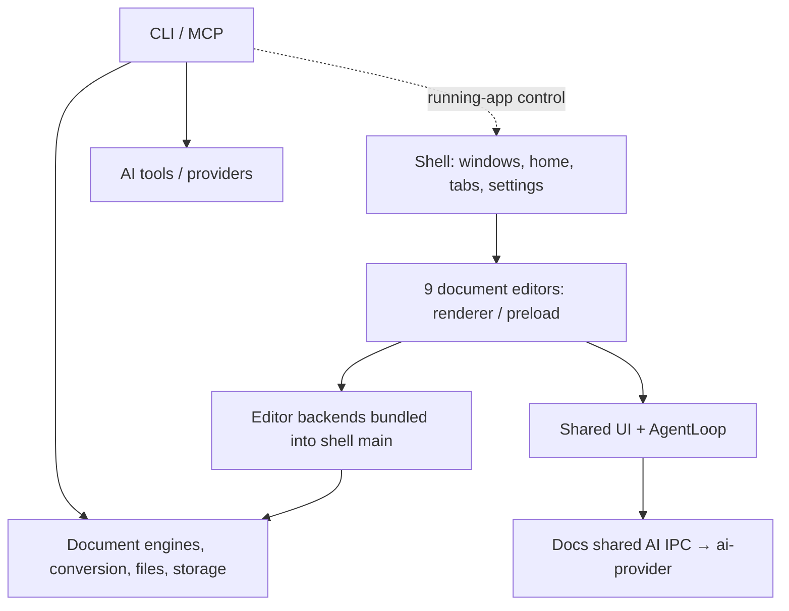

# Onyou Office codebase map

This guide maps the existing implementation and source entry points. Read the affected module before relying on a fixed architectural snapshot. The original map was based on IeumOffice `cca94cf0c65d9022c5fc96500b60847963aea841`; the [upstream maintenance guide](../UPSTREAM-INTEGRATION.md) records the accepted later baseline and release-preparation scope.

## System shape

There are **10 application workspaces**, but the installed product is **one Electron shell**. The other nine applications are document editors. **25 shared packages** provide document processing, AI, UI, storage and command-line functionality. The analyzed revision contains 8,442 Git-tracked files, including tests, documentation and assets.

This diagram summarizes responsibilities and representative execution paths. Some engines also run in renderers; provider calls run in main or headless contexts. It does not enumerate every import.

## Three important boundaries

1. **Renderer and application host.** Each editor has renderer and preload code. Shell imports editor main code through relative paths and bundles it into one process. Editor tabs use WebContentsView. Changes under `apps/*/src/main` therefore need to be understood in the context of the Shell build. Sources: [Shell main](../../../apps/shell/src/main/index.ts), [build configuration](../../../apps/shell/electron.vite.config.ts), [Shell guide](../../../apps/shell/AGENTS.md).
2. **App tools and model calls.** Renderer-side agent-core alternates model responses and app-owned tool execution. Docs registers the installed application's shared `ai:*` IPC handlers. ai-provider selects a provider and performs one model turn. Standalone editors can register handlers differently. Sources: [existing AI flow](../../architecture.md), [Docs main](../../../apps/docs/src/main/docs-main.ts), [agent-core guide](../../../packages/agent-core/AGENTS.md).
3. **Editing UI and file formats.** Editors use document models and engines, with different serialization paths. Sheets uses a Rust sidecar; HWP uses rhwp/WASM; PDF uses PDF.js, pdf-lib and PDFium. A JS/TS import graph alone cannot represent all these boundaries. Use the [module map](MODULES.md) to find ownership.

## Reading order

- [Module map](MODULES.md): responsibilities, dependencies and source entry points for all 35 workspaces.
- [Upstream and fork changes](FORK.md): inherited areas, independent product changes and future upstream comparisons.
- [Development entry points](DEVELOPMENT.md): session bootstrap and task-specific code navigation.

Detailed inherited explanations remain in [architecture](../../architecture.md), [business rules](../../business-rules.md), [security](../../security.md), [contracts](../../contracts.md) and module AGENTS.md files. This guide connects those references to our baseline and navigation paths. Use [operations](../../operations.md) for installation, commands and checks.

## Analysis basis

The analysis combines module guides, workspace manifests, Shell configuration, independently generated static dependency data and the pinned upstream/product Git diff. Public or runtime entry sources from 43 files across all 35 workspaces were parsed, dependency relationships across 3,700 JS/TS source modules were compared, and representative execution, storage, AI and control boundaries were read in source. This establishes structural coverage, not a semantic review of every function or execution of every behavior. Large graph databases, copied snapshots, tool installations and exploratory validation records are not required to use this guide.

## Architecture findings

### 1. Directory boundaries differ from execution boundaries

Ten app directories do not represent ten separate deployed programs or servers. In the installed product, editor main code is bundled into Electron main while each editor retains its own renderer/preload. The `configure*Runtime` functions inject renderer/preload locations. Identify **the bundle and process consuming a change**, in addition to its directory.

### 2. Shared packages usually export source directly

Among the 25 package manifests, only CLI declares a build script. Most `exports` point at TypeScript source, which consuming app builds bundle. xlsx-gateway uses wildcard subpath exports. Restricted entry points such as `ai-provider/browser` and `epub-engine/core`, together with renderer aliases, separate browser-compatible code from Node-specific paths.

Sources: [ai-provider manifest](../../../packages/ai-provider/package.json), [xlsx-gateway manifest](../../../packages/xlsx-gateway/package.json), [EPUB renderer alias](../../../apps/epub/vite.renderer.config.ts). For a shared package change, identify the consuming app builds rather than assuming there is an independently built library artifact.

### 3. Dependencies extend beyond apps → packages

Some packages reuse application source. CLI DOCX operations import Docs editing operations; CLI HWP operations reuse the HWP plugin and save helpers. pdf-structure font handling imports a helper from apps/pdf. These are existing reuse relationships, not defects or approved refactoring targets established by this analysis.

Sources: [CLI DOCX path](../../../packages/cli/src/formats/docx.ts), [CLI HWP path](../../../packages/cli/src/formats/hwp-edit.ts), [PDF font dependency](../../../packages/pdf-structure/src/writeback/font.ts). Manifest dependencies alone omit some relative-source coupling; inspect source imports and build aliases as well.

### 4. Document AI and project agent mode have different execution owners

For ordinary document AI, **renderer AgentLoop executes app tools**, while the provider performs a model turn. The transport separates responses by requestId and forwards cancellation to main. Provider selection and protocol dispatch are separate functions.

In **project agent mode**, Shell agent-sessions starts a Claude/Codex session in a user-selected project folder and manages window ownership, permissions and termination. Its execution path and tool permissions differ from the ordinary document AI loop.

Sources: [AgentLoop](../../../packages/agent-core/src/loop.ts), [IPC transport](../../../packages/agent-core/src/electron-transport.ts), [provider selection](../../../packages/ai-provider/src/provider-selection.ts), [protocol dispatch](../../../packages/ai-provider/src/stream.ts), [agent sessions](../../../apps/shell/src/main/agent/agent-sessions.ts).

### 5. Document state ownership varies by format

| State                                   | Primary owner                                                  | Architectural implication                                       |
| --------------------------------------- | -------------------------------------------------------------- | --------------------------------------------------------------- |
| Tab order, active tab, detached windows | Shell / TabManager                                             | The app manages document-view lifetime                          |
| DOCX/ODT editing content                | Docs renderer editor/doc-state                                 | Renderer serialization and main file authorization are separate |
| PPTX sessions and transactions          | Slides main and pptx-engine/ops                                | Renderer canvas state is not the only document representation   |
| XLSX sessions, files and calculation    | Sheets main, Rust sidecar and pending renderer edits           | Distinguish UI state, edit plans and native sessions            |
| EPUB book, chapters and range edits     | Main EpubBookSession                                           | The renderer receives chapter data and sends edits              |
| Markdown/HTML/HWP/Mindmap edits         | Format-specific renderer/engine; main file and permission maps | Similar IPC patterns do not imply identical models or saves     |
| PDF structure/conversion jobs           | Shell per-job utilityProcess                                   | Rendering and structure analysis run in different contexts      |

Sources: editor [main entry points](MODULES.md), [Docs state](../../../apps/docs/src/renderer/doc-state.ts), [TabManager](../../../apps/shell/src/main/tab-manager.ts), [Sheets client](../../../apps/sheets/src/main/xlsx-sidecar-client.ts), [EPUB session](../../../apps/epub/src/main/book-session.ts), [PDF worker entry](../../../apps/shell/src/main/pdf-structure/pdf-structure-process.ts).

### 6. Documents, app records and user projects use separate storage

| Data                                | Location / ownership                                   | Source entry                                                 |
| ----------------------------------- | ------------------------------------------------------ | ------------------------------------------------------------ |
| Opened document                     | User-selected file path                                | Editor main per-view write grants and format-specific saving |
| App and AI settings                 | Product userData: app-settings.json / ai-settings.json | Shell main / Docs main                                       |
| Document projects and conversations | userData/projects; index/project JSON and chat JSONL   | packages/project-store/src/store.ts                          |
| User-selected project context       | .onyouoffice inside the project folder                 | folder-api and Shell projects trust/files/chat-store         |
| Tab restoration list                | userData/session-record.json                           | Shell session-record; contains no document body              |
| Unsaved recovery copies             | RecoveryStore and editor recovery contracts            | electron-utils and Shell/editor recovery code                |
| PDF/EPUB jobs and translations      | userData/pdf-store                                     | pdf-structure/store and Shell/editor store handlers          |

Sources: [project-store](../../../packages/project-store/src/store.ts), [project-folder contract](../../../packages/project-store/src/folder-api.ts), [Shell projects](../../../apps/shell/src/main/projects), [session record](../../../apps/shell/src/main/session-record.ts), [recovery coordination](../../../apps/shell/src/main/recovery-shell.ts), [result store](../../../packages/pdf-structure/src/store/index.ts).

Preserve these distinctions when changing identity, settings, conversation storage or document saving; their data must not be moved or overwritten together by assumption.

### 7. CLI and MCP have multiple execution paths

CLI follows runCli → registry → command → result/exit code. It supports direct headless engine execution and control of a running application. Running-app control uses endpoint metadata in product userData and a local socket/named pipe. Headless MCP and Shell's in-app MCP are also separate hosts.

Sources: [CLI registry construction](../../../packages/cli/src/cli.ts), [CLI MCP](../../../packages/cli/src/mcp), [Shell MCP](../../../apps/shell/src/main/mcp), [app control server](../../../apps/shell/src/main/control-server.ts), [external contracts](../../contracts.md).

### 8. Assess change impact through shared hubs and fork boundaries

Shell owns application lifetime and composition. ui/agent-core/ai-provider connect shared AI behavior. electron-utils connects file, security and execution boundaries. Engines own file models. A request concerning one screen may affect other editors when it changes a shared hub; a local UI edit does not automatically require reanalyzing every engine.

Our independent changes concentrate on product identity, data/registration paths, CLI/skill naming, external addresses/updates and development operations. Overlay upstream module changes with those fork boundaries to prioritize maintenance. See [fork changes](FORK.md) and [development entry points](DEVELOPMENT.md).
