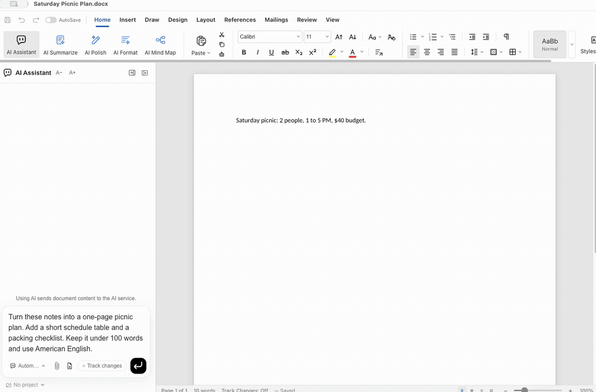
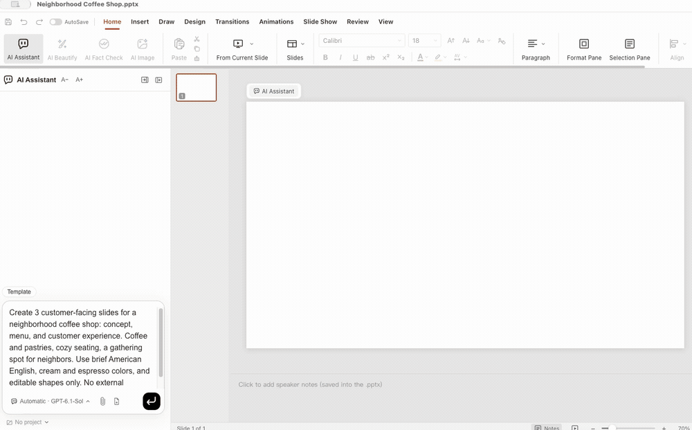
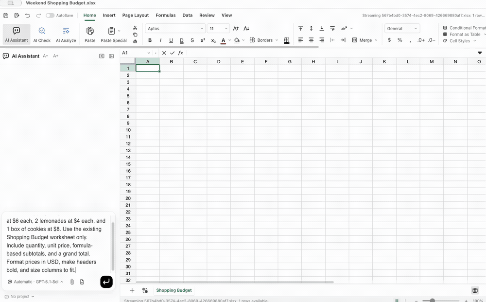
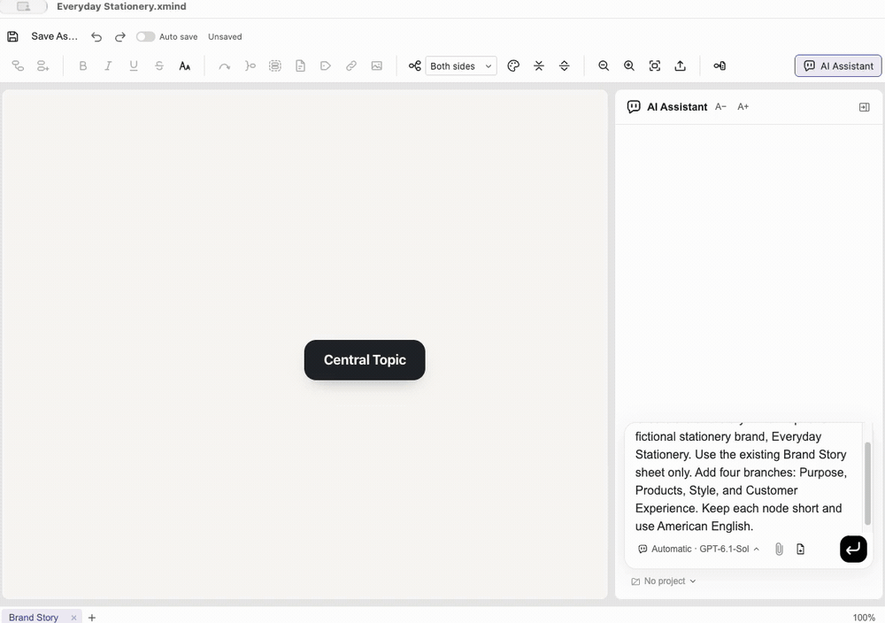

<!-- Modified by Onyou Office on 2026-11-04. -->

<p align="center">
  
</p>

<h1 align="center">온유오피스</h1>

<p align="center"><strong>AI 에이전트와 함께하는 나만의 오피스.</strong></p>

<p align="center">
  <a href="https://onyouoffice.com/">공식 홈페이지</a>
</p>

<p align="center">
  <a href="../../../LICENSE"></a>
  <a href="https://github.com/dodamworks/onyouoffice/actions/workflows/ci.yml"></a>
  <a href="https://github.com/dodamworks/onyouoffice/stargazers"></a>
  <a href="https://github.com/dodamworks/onyouoffice/releases/latest"></a>
  <a href="https://github.com/dodamworks/onyouoffice/releases"></a>
  
  
</p>

문서를 열고, 바꾸고 싶은 내용을 말하고, 같은 창에서 작업을 이어가세요. 온유오피스는 문서 편집기와 AI 에이전트를 한 데스크톱 앱에 담았습니다. AI로 초안을 쓰고 문서를 다듬거나 직접 편집할 수 있습니다. 앱은 무료 오픈소스이며, AI 연결은 선택입니다.

<details>
<summary>언어 선택 · 21개 언어</summary>

[English](../../../README.md) · [العربية](ar.md) · [Čeština](cs.md) · [Deutsch](de.md) · [Español](es.md) · [Français](fr.md) · [עברית](he.md) · [हिन्दी](hi.md) · [Bahasa Indonesia](id.md) · [Italiano](it.md) · [日本語](ja.md) · **한국어** · [Bahasa Melayu](ms.md) · [Nederlands](nl.md) · [Polski](pl.md) · [Português](pt.md) · [Русский](ru.md) · [ไทย](th.md) · [Tiếng Việt](vi.md) · [简体中文](zh.md) · [繁體中文](zh-TW.md) <!-- lang-switcher -->

</details>

## AI로 작성하고, 원하는 대로 다듬으세요

### 문서

[](../demos/document.mp4)

### 발표 자료

[](../demos/presentation.mp4)

### 스프레드시트

[](../demos/spreadsheet.mp4)

### 마인드맵

[](../demos/mindmap.mp4)

## 문서 작업을 한곳에서

- draw.io 다이어그램을 편집하고 Visio(.vsdx) 파일을 이 PC에서 새 다이어그램으로 가져옵니다.
- 문서·스프레드시트·프레젠테이션·한글(HWP/HWPX)을 작성하고 편집합니다. PDF·Markdown·HTML·마인드맵·EPUB도 다룹니다. 편집·변환 범위는 형식마다 다릅니다.
- AI 도우미에게 문서 수정을 요청하고, 지식 창고에서 선택한 문서 범위를 바탕으로 질문합니다. 프로젝트에는 지침·기억·파일·대화를 모아 둡니다.
- 21개 화면 언어, 밝은·어두운 테마, AI 채팅 글자 크기 조절을 지원합니다. 온유오피스는 첫 실행·홈·AI 패널·프로젝트·지식 창고를 정리하고 브랜드와 설치·데이터 경로를 분리했습니다.

## 시작하기

[릴리스](https://github.com/dodamworks/onyouoffice/releases/latest)에서 설치 파일을 받으세요. Windows x64, macOS(Apple Silicon·Intel, 베타), Linux x64(베타)를 제공합니다. 업데이트는 현재 수동으로 설치합니다. 소스에서 직접 빌드하려면 Node.js 24, npm, Rust(`cargo`), 운영체제별 네이티브 빌드 도구가 필요합니다.

```sh
git clone https://github.com/dodamworks/onyouoffice.git
cd onyouoffice
npm ci
npm run fixtures
npm run build:all
npm run dev
```

홈에서 파일을 열거나 새 문서를 만드세요. AI가 필요하면 **설정 → AI**에서 연결을 고른 뒤 문서의 AI 도우미에 요청을 입력하세요.

[CONTRIBUTING](../../../CONTRIBUTING.md) · [Architecture](../../architecture.md)

## AI·비용·개인정보

AI 계정 없이 문서를 편집할 수 있습니다. AI 구독·API 요금·사용 한도는 각 제공자 조건을 따릅니다. Codex·Claude·ChatGPT 직접 로그인·OpenRouter·Gemini·API 키·로컬 AI 연결 경로가 있으며, 준비 조건과 사용 가능 여부는 다릅니다. AI를 쓰면 관련 문서 내용·첨부·대화가 선택한 제공자에게 전송됩니다. 개발 실행과 설치본은 앱 데이터 폴더가 다릅니다.

[Privacy](../../../PRIVACY.md)

공식 Codex 프로그램으로 지식 창고 질문과 후속 대화를 확인했습니다. ChatGPT 직접 로그인에는 제공자 동의 오류가 남아 있습니다. 모든 형식의 동일한 렌더링이나 완전한 호환성을 보장하지 않습니다.

[Known issues](../../tracking/findings.md) · [Release status](../../PUBLIC-RELEASE.md)

## 도움과 기여

버그·개선 제안·번역·코드 기여를 환영합니다. 합성 예제로 재현하고 개인 문서·키·계정 정보는 공개하지 마세요. 기타 문의: **support@onyouoffice.com**.

[Issues](https://github.com/dodamworks/onyouoffice/issues) · [Pull requests](https://github.com/dodamworks/onyouoffice/pulls) · [Security](../../../SECURITY.md)

## 라이선스와 출처

온유오피스는 IeumOffice의 독립 포크이며, 그 원본은 GenOffice입니다. 문서 엔진과 많은 편집 기능은 원본 프로젝트·rhwp·오픈소스 기여자들의 작업입니다. 원본 출처와 저작자 표시를 보존하며, 온유오피스가 모든 기능을 직접 만들었다고 주장하지 않습니다. 프로젝트 소스는 Apache-2.0, 제3자 구성 요소는 각각의 조건을 따릅니다. 상표 사용권은 별도이며, 원본 프로젝트나 AI·문서 형식 제공자와의 제휴·후원을 주장하지 않습니다.

[IeumOffice](https://github.com/pblsketch/ieumoffice) → [GenOffice](https://github.com/genspark-ai/genoffice)

[Apache-2.0](../../../LICENSE) · [NOTICE](../../../NOTICE) · [Contributors](../../../CONTRIBUTORS.md) · [Trademarks](../../../TRADEMARKS.md) · [Source history](../SOURCE-HISTORY.md)
